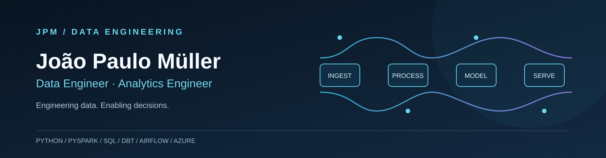

<<<<<<< HEAD
# Hey, I'm João Paulo Müller 📊
**Data Engineer · Analytics Engineer**
=======

  

  
  
  

>>>>>>> dd1df72 ((upnew): New profile design testing!)

## About Me

I'm a **Data Engineer and Analytics Engineer** focused on building scalable pipelines, reliable analytical models, and automated data workflows. I work across distributed processing, cloud data platforms, orchestration, SQL optimization, and business intelligence to turn complex data into actionable insights.

## ⚡ Core Expertise

| Domain | What I Build |
| --- | --- |
| **Distributed Data Processing** | Scalable ETL/ELT pipelines with **Python** and **PySpark** for large-volume data workloads. |
| **Analytics Engineering** | Dimensional models and tested transformations using **dbt** and **Azure Data Lake** environments. |
| **Orchestration & Automation** | Scheduled, end-to-end workflows with **Apache Airflow**, **Apache Hop**, and **Jenkins**. |
| **Databases & Query Performance** | SQL modeling and optimization across **Oracle**, **SQL Server**, and **Hive**. |
| **Data Products & BI** | Interactive **Power BI** dashboards that translate complex business rules into decision-ready insights. |

## 🚀 Featured Projects

### [Data Engineering & AI Solutions](https://github.com/Shamslux/Data-Engineering-AI-Solutions/tree/main)
A curated collection of end-to-end data engineering projects exploring **ETL/ELT architecture**, **data quality**, and **AI-enabled workflows**.

### [Libro Tradukisto](https://github.com/Shamslux/libro-tradukisto)
A **Python CLI** for translating `.epub` books for the Esperanto community using LLM integrations and API wrappers. Demonstrates Python application development, external API integration, and practical automation.

## 🧰 Tech Stack

**Data Engineering & Databases**

    

**Orchestration, Big Data & Analytics**

      

**Backend**

**DevOps & Cloud**

    

**Frontend (Secondary)**

  

---

<<<<<<< HEAD
## 🏗️ Core Engineering & Data Deliverables

* **Scalable Distributed Processing**  
  Design and optimization of complex data pipelines using **PySpark and Python** to process large volumes of data.

* **Modern Analytics Engineering**  
  Dimensional modeling and robust data transformations within **Azure Data Lake** environments, leveraging **dbt** to ensure high data quality and governance.

* **Workflow Automation & Orchestration**  
  Centralizing and scheduling end-to-end automated workflows using **Apache Airflow, Apache Hop, and Jenkins**.

* **Enterprise Database Architecture**  
  Dimensional modeling and tuning of complex SQL queries across corporate relational and distributed systems (**Oracle, SQL Server, and Hive**).

* **Data Products & Insights**  
  Developing interactive **Power BI** dashboards integrated with complex business rules, translating raw data into actionable strategic insights for stakeholders.

---

## 🏆 Highlighted Work

* 📁 **[Data-Engineering-AI-Solutions](https://github.com/Shamslux/Data-Engineering-AI-Solutions/tree/main)**  
  A curated repository of end-to-end data engineering projects. Demonstrates expertise in designing scalable ETL/ELT pipelines, implementing data quality frameworks, and integrating AI-driven workflows into modern data architectures.

* 🌐 **[Libro Tradukisto](https://github.com/Shamslux/libro-tradukisto)**  
  A high-utility Python CLI tool designed for the Esperanto community. It bridges the gap between language accessibility and AI by automating the translation of `.epub` literature using LLM integrations and free API wrappers, showcasing end-to-end software development and API orchestration skills.

---

## 🛠 Tech Stack

| Category | Technologies |
| :--- | :--- |
| **Data Engineering & Databases** |      |
| **Orchestration, Big Data & Analytics** |      |
| **Backend & Frameworks** |  |
| **DevOps & Cloud** |      |
| **Secondary / Frontend** |    |

---

## 📫 Let's Connect

=======

Engineering data · Enabling decisions

>>>>>>> dd1df72 ((upnew): New profile design testing!)
