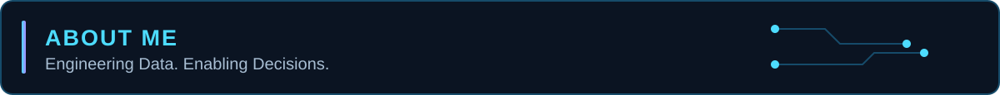
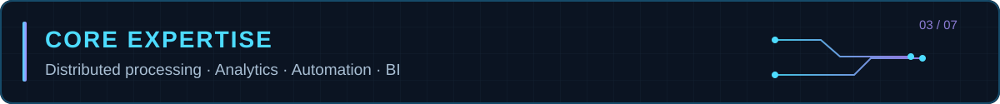
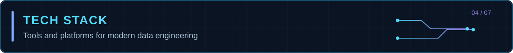
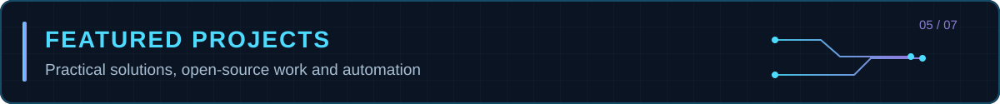
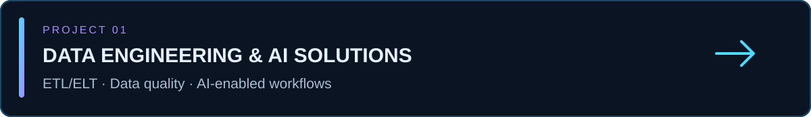
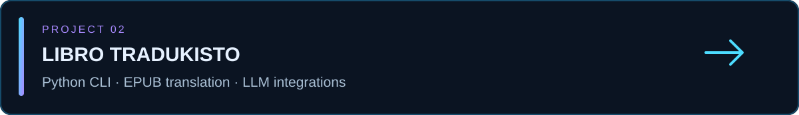
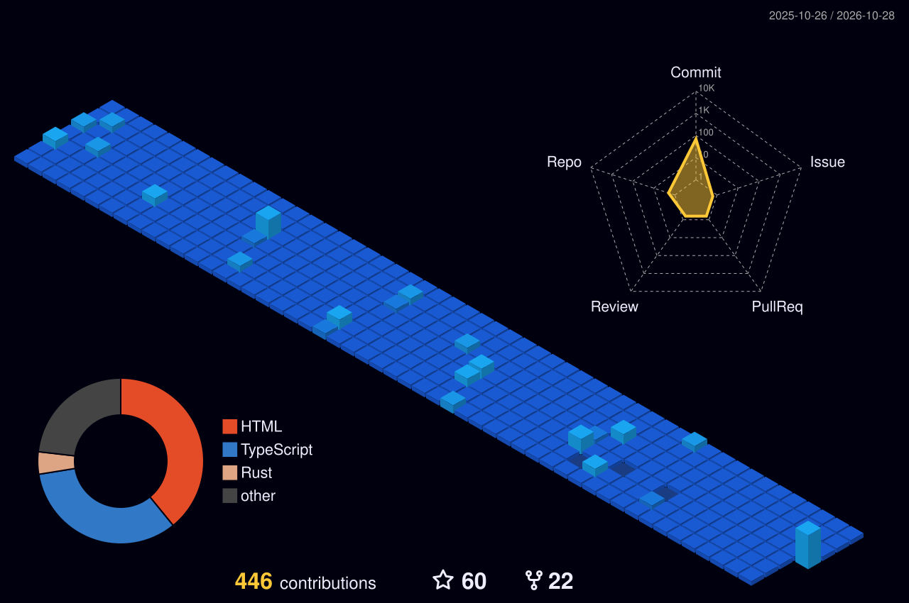
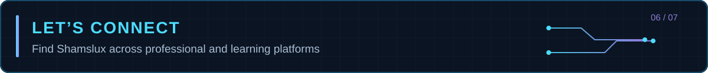
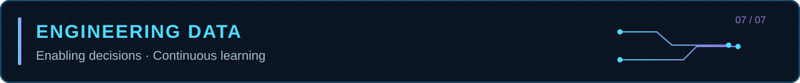

  

 

  

I'm **João Paulo Müller (Shamslux)**, a **Data Engineer and Analytics Engineer** focused on scalable pipelines, reliable analytical models, and automated data workflows. I work across distributed processing, cloud data platforms, orchestration, SQL optimization, and business intelligence to turn complex data into actionable insights.

 

  

| Domain | What I Build |
| :--- | :--- |
| **Distributed Data Processing** | Scalable ETL/ELT pipelines using **Python** and **PySpark** for large-volume workloads. |
| **Analytics Engineering** | Dimensional models and tested transformations using **dbt** in **Azure Data Lake** environments. |
| **Orchestration & Automation** | End-to-end workflows with **Apache Airflow**, **Apache Hop**, and **Jenkins**. |
| **Databases & Query Performance** | SQL modeling and optimization across **Oracle**, **SQL Server**, and **Hive**. |
| **Data Products & BI** | **Power BI** dashboards that turn business rules into decision-ready insights. |

 

  

**Data Engineering & Databases**

    

**Orchestration, Big Data & Analytics**

       

**Backend & Desktop Applications**

**DevOps & Cloud**

    

**Frontend (Secondary)**

     

 

  

A curated collection of end-to-end data engineering projects exploring **ETL/ELT architecture**, **data quality**, and **AI-enabled workflows**. [Explore the repository](https://github.com/Shamslux/Data-Engineering-AI-Solutions/tree/main).

An open-source **desktop EPUB translation application** built with **Tauri v2, Rust, React, TypeScript, and Vite**. Combines a native Rust backend with a React interface, structural XHTML processing, human translation review, and integrations with **Google Translate, Gemini, OpenAI, Claude, and local AI endpoints**. Includes signed Windows installers and an in-app update mechanism. **Experimental release: v0.1.2**; EPUB export and end-to-end translation validation are ongoing. [Explore the repository](https://github.com/Shamslux/libro-tradukisto) · [Latest release](https://github.com/Shamslux/libro-tradukisto/releases/latest).

 

  

 

  
   
  
  
  

 

  

